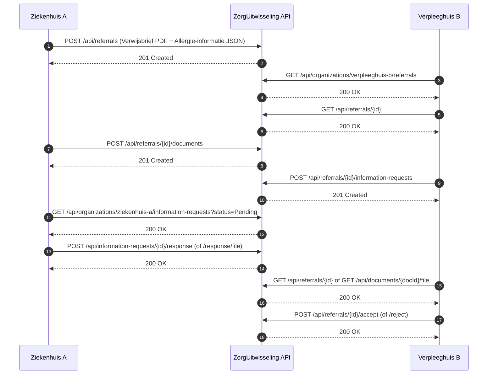

# ZorgUitwisseling API


Dit is een .NET 10 REST API gemaakt door **Luuk Pastor** voor het ChipSoft Junior .NET Developer [Assessment](REQUIREMENTS.md).

De applicatie maakt het mogelijk om:
- Verwijzingen aan te maken tussen zorginstellingen met bijbehorende verwijsbrieven (PDF) en allergie-informatie (JSON).
- Aanvullende documenten of informatie (zoals een medicatieoverzicht) op te vragen en aan te leveren.
- Patiëntverwijzingen te accepteren of af te wijzen.

## Starten van de applicatie

De API is lokaal te draaien met de .NET 10 SDK of via Docker Compose.

### Lokaal

```shell
# vanuit `ChipSoftZorgUitwisseling/`
dotnet restore
dotnet run --project ZorgUitwisseling.Api
```

De API draait standaard op `http://localhost:5119`:
- **Scalar UI (API documentatie):** [http://localhost:5119/scalar/v1](http://localhost:5119/scalar/v1)
- **OpenAPI specificatie:** [http://localhost:5119/openapi/v1.json](http://localhost:5119/openapi/v1.json)

### Via Docker Compose

```sh
# vanuit `ChipSoftZorgUitwisseling/`
docker compose up --build
```

De API is dan bereikbaar op `http://localhost:8080` (met Scalar op [http://localhost:8080/scalar/v1](http://localhost:8080/scalar/v1)).
> [!NOTE]
> Als je [`ChipSoftZorgUitwisseling.http`](ZorgUitwisseling.Api/ChipSoftZorgUitwisseling.http) wilt testen moet je de port daar veranderen naar `:8080`.

## Hoe het werkt



Alle scenario's zijn uit te voeren in [`ChipSoftZorgUitwisseling.http`](ZorgUitwisseling.Api/ChipSoftZorgUitwisseling.http) met Rider of VS Code. Bij het opstarten worden de voorbeeldorganisaties `ziekenhuis-a` en `verpleeghuis-b` automatisch aangemaakt.

## Ontwerpkeuzes

- Zolang een verwijzing openstaat, kunnen extra documenten en informatieverzoeken worden toegevoegd. Als deze gesloten is, is dit niet meer toegestaan (`409 Conflict`).
- Voor opslag is gekozen voor SQLite. Zo blijft de data bewaard bij herstarten, maar hoef je geen losse databaseserver te hebben draaien.

- Bij het aanmaken van een verwijzing wordt de verwijsbrief als PDF meegestuurd en allergie-informatie als JSON.
- Beide zijn verplicht om mee te sturen, zodat een gebrek aan allergie-informatie niet wordt opgevat als "geen allergieën".
- Tekst en `.pdf`-bestanden kunnen worden verstuurd.
- Elk document is via `GET /api/documents/{id}/file` te downloaden.

- Inkomende requests worden gevalideerd met DataAnnotations en `IValidatableObject`.
- Exceptions worden via `GlobalExceptionHandler` omgezet naar .NET `ProblemDetails`.
- BSN's worden gevalideerd met de [11-proef](https://nl.wikipedia.org/wiki/Elfproef).
- PDF-bestanden worden op `.pdf`-extensie, `%PDF-`-header en grootte gecontroleerd.

- Elke stap van een referral wordt vastgelegd in de database en via `ILogger` (pas nadat opslaan in de database is geslaagd).
- In de logs worden alleen de organisaties, tijdstippen, het soort actie en het documenttype opgeslagen.
- Patiëntgegevens en medische inhoud worden bewust buiten de logs gelaten.

- Bewust gekozen voor Minimal API's en één service-laag i.p.v. meerdere projecten en controllers om het overzichtelijk en onderhoudbaar te houden voor het assessment.
- Autorisatie is eenvoudig toe te voegen, omdat stuurder en ontvanger al worden vastgelegd.

## Tests uitvoeren

Er zijn unit- en integratietests geschreven in het testproject [`ZorgUitwisseling.Tests`](ZorgUitwisseling.Tests/ZorgUitwisseling.Tests.csproj):

```powershell
dotnet test ChipSoftAssessment.sln
```
